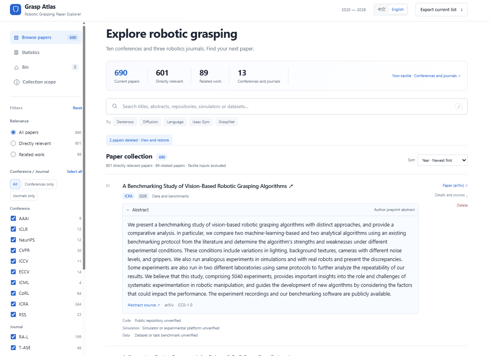

# Grasp Atlas

**English** | [简体中文](README.zh-CN.md)

**An offline literature browser for robotic grasping research.**

Grasp Atlas brings papers, abstracts, code repositories, datasets and verified local PDFs into one searchable workspace. It helps researchers explore a field, compare approaches and build a focused reading collection without losing track of the sources behind each entry.

Open the application directly in your browser, or run the local Python server to download papers and manage your library. The interface supports both English and Chinese.



## What you can do

- **Find relevant papers.** Search titles, abstracts and resource metadata; filter by conference, journal, year, research topic and relevance.
- **Explore research trends.** Browse interactive venue and year charts, topic distributions, keyword rankings and a conference–year heatmap.
- **Move from a paper to its resources.** Find author code, datasets, simulation platforms and publication links alongside each entry, with source and verification notes.
- **Build an offline reading library.** Download available PDFs with resume support and title verification, then open verified local copies from the browser.
- **Shape your own collection.** Remove and restore papers through the recycle bin, preserve choices across sessions and export filtered lists as CSV.
- **Review the curation.** Inspect recorded inclusion and exclusion decisions, publication details and the distinction between sourced abstracts and editorial summaries.

## Research scope

The collection centers on grasping as a research problem: grasp detection, 6-DoF pose generation, dexterous and task-oriented grasping, planning, control, datasets and benchmarks. It also includes perception methods that directly support grasping, such as scene reconstruction, shape completion, depth recovery, NeRF and 3D Gaussian Splatting.

Sources include selected main-conference papers from **AAAI, ICLR, NeurIPS, CVPR, ICCV, ECCV, ICML, CoRL, ICRA and RSS**, plus journal papers from **RA-L, T-ASE and T-RO**, from 2020 onward.

The default scope excludes areas such as in-hand manipulation, whole-body grasping, garment/cloth grasping, soft grippers and deformable-object grasping. Detailed criteria, evidence and individual decisions are kept in the [curation records](editable-site/curation/) so the collection can be reviewed and refined.

## Quick start

### Browse immediately

```sh
git clone https://github.com/YitianShi/grasp-atlas.git
cd grasp-atlas
```

Open [`index.html`](index.html) in your browser. Browsing, searching, filtering and charts work without a build step or a server. External links and new downloads require an internet connection.

### Enable downloads and library management

With **Python 3.10 or later**, run:

```sh
python -m pip install -r Grasp_Atlas_Downloader/Grasp_Atlas_Downloader/requirements.txt
python atlas_server.py
```

The application opens at `http://127.0.0.1:8765/`. On Windows, you can also double-click [`Start_Grasp_Atlas.cmd`](Start_Grasp_Atlas.cmd).

Use **Download / retry all** to download the current browser collection. Papers in the recycle bin are skipped; restored papers are included. Downloads can be resumed, and unavailable or unverified full texts are marked explicitly.

For command-line downloads, run:

```sh
python Grasp_Atlas_Downloader/Grasp_Atlas_Downloader/start_download.py --retry
```

Windows users can also use [`Download_All_Papers.cmd`](Download_All_Papers.cmd). See the [local usage guide](START_HERE.txt) for additional details.

## Your local library

Paper PDFs are downloaded separately and are not distributed with this repository. The downloader creates `GraspAtlas_Library/` and `library.js`; the browser uses these to open verified local copies. Downloads, local state, generated reports, Python environments and caches are excluded from Git.

Ordinary deletion and restoration are saved in the current browser. **Delete permanently**, available through the local server, removes a paper's metadata, local PDFs, download records and related screening records from the project after confirmation. It cannot be undone through the recycle bin.

Sources and license information remain attached to the corresponding papers and resources. Availability varies, and preprints may differ from their published versions.

## Project layout

| Path | Purpose |
| --- | --- |
| [`index.html`](index.html) | Standalone offline application |
| [`editable-site/dist/`](editable-site/dist/) | Editable interface, application logic and paper data |
| [`editable-site/curation/`](editable-site/curation/) | Screening decisions and source evidence |
| [`Grasp_Atlas_Downloader/Grasp_Atlas_Downloader/`](Grasp_Atlas_Downloader/Grasp_Atlas_Downloader/) | Catalogue, source resolution, downloading and PDF verification |
| [`atlas_server.py`](atlas_server.py) / [`paper_purge.py`](paper_purge.py) | Local service and permanent library cleanup |
| [`scripts/check.py`](scripts/check.py) | Build and repository checks |

## Development

Edit the source in `editable-site/dist/`, then rebuild the standalone application:

```sh
python editable-site/build_offline.py
```

With Node.js and the Python dependencies installed, run the checks:

```sh
python scripts/check.py
```

Checks cover application behavior, curation consistency, permanent paper identifiers and the downloader. Downloaded papers are not required.

When updating the catalogue, keep `catalogue.json` and `editable-site/dist/data.js` synchronized. Preserve existing `catalogueId` values; they connect paper entries, local PDFs and personal collection choices.
