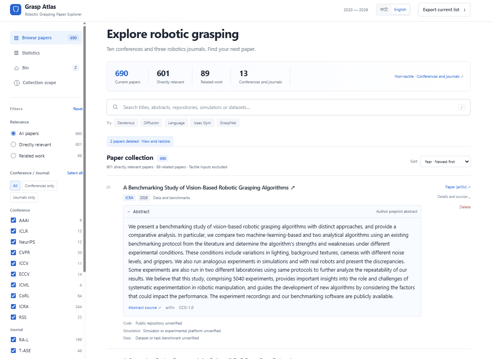

# Grasp Atlas

[English](README.md) | **简体中文**

**面向机器人抓取研究的离线论文浏览器。**

Grasp Atlas 将论文、摘要、代码仓库、数据集和已核验的本地 PDF 整理到一个可搜索的工作空间中，帮助研究者了解研究方向、比较不同方法，并建立自己的阅读清单，同时保留每篇论文的信息来源。

你可以直接在浏览器中打开应用，也可以运行本地 Python 服务来下载论文和管理文献库。应用界面支持英文与中文切换。



## 你可以用它做什么

- **查找相关论文。** 搜索标题、摘要和资源信息，按会议、期刊、年份、研究方向及相关程度筛选。
- **了解研究分布。** 通过可交互的发表来源与年度图表、方向分布、关键词排行及会议–年份热力图探索文献。
- **从论文找到研究资源。** 在同一条目中查看作者代码、数据集、仿真平台和发表链接，并核对来源与验证说明。
- **建立离线阅读库。** 下载可获取的 PDF，支持断点续传与标题核验，再从浏览器打开已验证的本地全文。
- **整理个人清单。** 通过回收站删除或恢复论文，保留跨会话的个人选择，并将筛选结果导出为 CSV。
- **复查收录依据。** 查看纳入与排除判定、发表信息，以及来源摘要和编辑概述的区别。

## 研究范围

文献库以抓取问题为主线，涵盖抓取检测、6-DoF 位姿生成、灵巧手与任务导向抓取、规划、控制、数据集和基准。也收录直接支持抓取的感知研究，例如场景重建、形状补全、深度恢复、NeRF 与 3D Gaussian Splatting。

来源包括 **AAAI、ICLR、NeurIPS、CVPR、ICCV、ECCV、ICML、CoRL、ICRA、RSS** 的部分主会论文，以及 **RA-L、T-ASE、T-RO** 的期刊论文，收录年份从 2020 年起。

默认范围排除手内操作、全身抓取、衣物/布料抓取、软体夹爪和可变形物体抓取等方向。详细规则、证据与逐篇判定保存在[筛选记录](editable-site/curation/)中，便于持续复查和调整文献库。

## 快速开始

### 直接浏览

```sh
git clone https://github.com/YitianShi/grasp-atlas.git
cd grasp-atlas
```

在浏览器中打开 [`index.html`](index.html)，即可使用浏览、搜索、筛选和统计图表，无需构建或启动服务。访问外部链接和下载新论文需要网络连接。

### 启用下载和文献库管理

安装 **Python 3.10 或更新版本**后运行：

```sh
python -m pip install -r Grasp_Atlas_Downloader/Grasp_Atlas_Downloader/requirements.txt
python atlas_server.py
```

应用会在 `http://127.0.0.1:8765/` 打开。Windows 用户也可以双击 [`Start_Grasp_Atlas.cmd`](Start_Grasp_Atlas.cmd)。

点击“下载 / 重试全部”，即可下载当前浏览器清单中的论文；回收站中的论文会跳过，恢复后的论文会纳入下载。下载支持续传，无法获取或尚未通过核验的全文会明确标记。

也可以通过命令行启动下载：

```sh
python Grasp_Atlas_Downloader/Grasp_Atlas_Downloader/start_download.py --retry
```

Windows 用户还可以使用 [`Download_All_Papers.cmd`](Download_All_Papers.cmd)。更多操作说明见[本地使用指南](START_HERE.txt)。

## 本地文献库

论文 PDF 需要单独下载，不随仓库分发。下载器会生成 `GraspAtlas_Library/` 和 `library.js`，浏览器通过它们打开已核验的本地全文。下载文件、本地状态、生成的报告、Python 环境和缓存均由 Git 忽略。

普通删除和恢复选择保存在当前浏览器中。通过本机服务使用“永久删除”并确认后，会从项目中清理该论文的元数据、本地 PDF、下载记录及相关筛选记录，不能通过回收站恢复。

论文和研究资源的来源与许可信息保留在对应条目中。公开全文的可获取情况各不相同，预印本与正式发表版本也可能存在差异。

## 项目结构

| 路径 | 用途 |
| --- | --- |
| [`index.html`](index.html) | 可独立打开的离线应用 |
| [`editable-site/dist/`](editable-site/dist/) | 可编辑的界面、应用逻辑与论文数据 |
| [`editable-site/curation/`](editable-site/curation/) | 筛选判定及来源证据 |
| [`Grasp_Atlas_Downloader/Grasp_Atlas_Downloader/`](Grasp_Atlas_Downloader/Grasp_Atlas_Downloader/) | 论文目录、来源解析、下载与 PDF 核验 |
| [`atlas_server.py`](atlas_server.py) / [`paper_purge.py`](paper_purge.py) | 本机服务与永久清理功能 |
| [`scripts/check.py`](scripts/check.py) | 构建与仓库检查 |

## 开发

修改 `editable-site/dist/` 中的源码后，重建独立应用：

```sh
python editable-site/build_offline.py
```

安装 Node.js 和 Python 依赖后，运行检查：

```sh
python scripts/check.py
```

检查涵盖应用行为、筛选数据一致性、论文永久编号及下载器，不要求事先下载论文。

更新论文目录时，请同步 `catalogue.json` 与 `editable-site/dist/data.js`，并保留已有 `catalogueId`，以维持论文条目、本地 PDF 和个人清单选择之间的对应关系。
